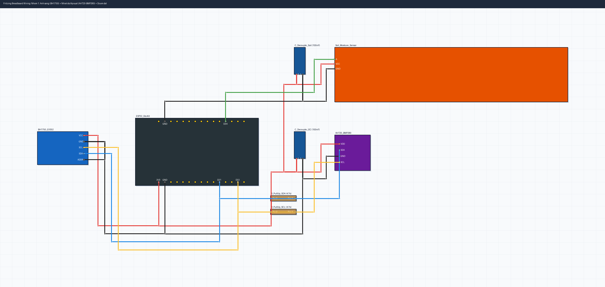

# Hướng Dẫn Test Nhóm 1: Cảm Biến Ánh Sáng (BH1750) - Nhiệt Độ, Áp Suất (AHT20 + BMP280) - Độ Ẩm Đất

## 1. Danh mục linh kiện & Sơ đồ đấu dây (File Fritzing: `group1_env_sensors.fzz`)

### Linh kiện cần chuẩn bị:
- **Vi điều khiển**: ESP32 DevKit V1 (30 chân)
- **Cảm biến ánh sáng**: Module GY-302 (`BH1750`)
- **Cảm biến nhiệt độ, độ ẩm, áp suất**: Module tích hợp `AHT20 + BMP280`
- **Cảm biến độ ẩm đất**: `DFRobot Capacitive Soil Moisture Sensor V1.0`
- **Linh kiện phụ trợ bắt buộc**:
  - `2 x Điện trở 4.7kΩ`: Điện trở kéo lên (Pull-up) cho 2 đường `SDA` và `SCL` lên `3.3V`.
  - `2 x Tụ gốm 100nF (104)`: Mắc song song giữa `3.3V` và `GND` gần cụm cảm biến I2C và cảm biến độ ẩm đất để lọc nhiễu nguồn.

### Bảng đấu nối chi tiết:

| Module | Chân Module | Chân ESP32 | Màu dây Fritzing | Ghi chú |
| :--- | :--- | :--- | :--- | :--- |
| **BH1750** | `VCC` | `3V3` | Đỏ | Nguồn 3.3V |
| | `GND` | `GND` | Đen | Mass chung |
| | `SDA` | `GPIO21 (D21)` | Xanh dương | Nối chung bus I2C SDA (+ trở kéo lên `4.7kΩ` lên `3V3`) |
| | `SCL` | `GPIO22 (D22)` | Vàng | Nối chung bus I2C SCL (+ trở kéo lên `4.7kΩ` lên `3V3`) |
| | `ADDR` | `GND` | Đen | Cố định địa chỉ I2C = `0x23` |
| **AHT20 + BMP280** | `VDD` | `3V3` | Đỏ | Nguồn 3.3V (+ tụ lọc `100nF` sát chân `VDD-GND`) |
| | `GND` | `GND` | Đen | Mass chung |
| | `SDA` | `GPIO21 (D21)` | Xanh dương | Địa chỉ AHT20 = `0x38`, BMP280 = `0x77` (hoặc `0x76`) |
| | `SCL` | `GPIO22 (D22)` | Vàng | Nối chung bus I2C SCL |
| **Độ ẩm đất** | `VCC` | `3V3` | Đỏ | Cấp 3.3V (+ tụ lọc `100nF` sát chân `VCC-GND`) |
| | `GND` | `GND` | Đen | Mass chung |
| | `A` (Analog Out) | `GPIO34 (D34)` | Xanh lá | Chân `ADC1_CH6` (12-bit ADC) |

---

## 2. Cách nạp Firmware và Kiểm tra trên VS Code (PlatformIO)

1. Mở thư mục `d:\Plant\sensor\1_env_sensors` bằng VS Code.
2. Nhấn nút **PlatformIO: Upload** ở thanh công cụ dưới cùng để biên dịch và nạp code vào ESP32.
3. Mở **PlatformIO: Serial Monitor** (Baudrate `115200`).

### Các bước nghiệm thu:
1. **Kiểm tra nhận diện I2C**:
   - Ngay khi khởi động (hoặc khi gõ phím `s`), chương trình sẽ quét bus I2C và liệt kê đủ 3 địa chỉ:
     - `0x23`: BH1750 (Cảm biến ánh sáng)
     - `0x38`: AHT20 (Nhiệt độ & Độ ẩm)
     - `0x77` (hoặc `0x76`): BMP280 (Áp suất khí quyển)
2. **Kiểm tra BH1750**:
   - Che tối cảm biến -> Độ rọi giảm xuống `< 10 Lux` (Trạng thái: `Trời tối / Tắt đèn`).
   - Chiếu đèn bàn / đèn flash -> Độ rọi tăng lên `500 - 5000+ Lux`.
3. **Kiểm tra AHT20 & BMP280**:
   - Nhiệt độ phòng hiển thị chính xác (`25 - 33 °C`), độ ẩm (`40 - 80 %RH`), áp suất khí quyển (`~1005 - 1015 hPa`).
4. **Hiệu chuẩn & kiểm tra cảm biến Độ ẩm đất**:
   - Để đầu dò cảm biến khô ngoài không khí -> Gõ phím **`d`** trong Serial Monitor để lưu mốc **0% (Khô)**.
   - Nhúng đầu dò cảm biến vào cốc nước (chỉ nhúng đến vạch giới hạn trắng) -> Gõ phím **`w`** để lưu mốc **100% (Ướt)**.
   - Gõ phím **`r`** nếu muốn khôi phục mốc mặc định (`Dry = 2850 mV`, `Wet = 1250 mV`).
