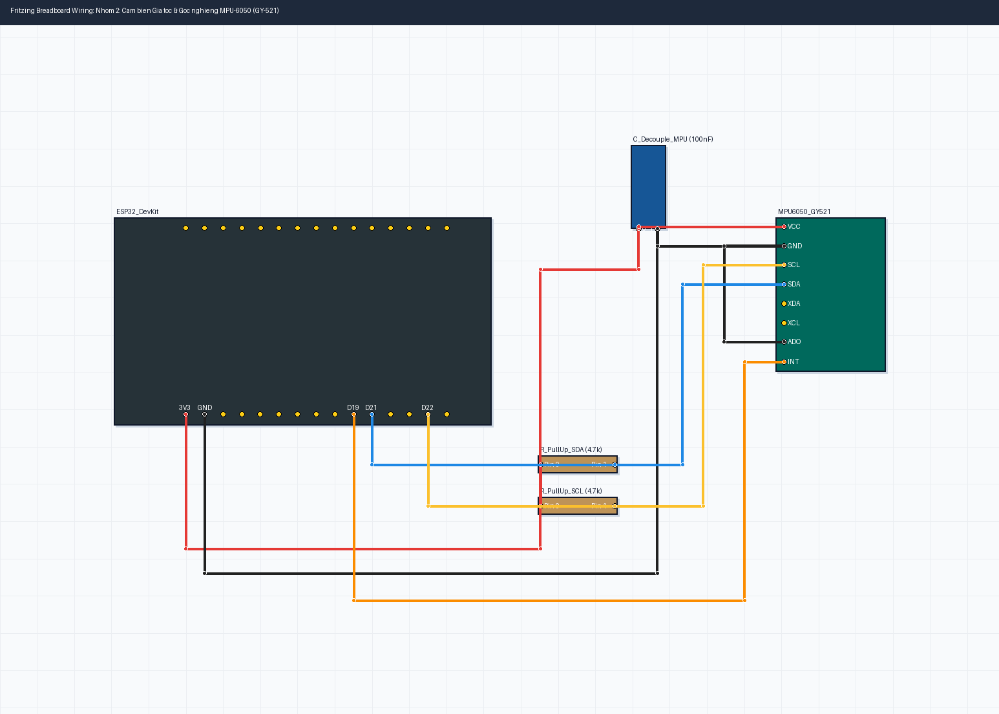

# Hướng Dẫn Test & Hiệu Chỉnh Nhóm 2: Cảm Biến Gia Tốc & Góc Nghiêng MPU-6050 (GY-521)

## 1. Danh mục linh kiện & Sơ đồ đấu dây (File Fritzing: `group2_mpu6050.fzz`)

### Linh kiện cần chuẩn bị:
- **Vi điều khiển**: ESP32 DevKit V1 (30 chân)
- **Cảm biến IMU**: Module `MPU-6050 (GY-521)` (Gia tốc 3 trục + Con quay hồi chuyển 3 trục)
- **Linh kiện phụ trợ bắt buộc**:
  - `2 x Điện trở 4.7kΩ`: Kéo lên (Pull-up) cho 2 đường `SDA` và `SCL` lên `3.3V`.
  - `1 x Tụ gốm 100nF (104)`: Mắc sát chân `VCC` và `GND` của MPU-6050 để giảm nhiễu rung (noise floor).

### Bảng đấu nối chi tiết:

| Chân MPU-6050 | Chân ESP32 | Màu dây Fritzing | Ghi chú |
| :--- | :--- | :--- | :--- |
| `VCC` (pin 1) | `3V3` | Đỏ | Nguồn 3.3V (+ tụ lọc `100nF` sát chân `VCC-GND`) |
| `GND` (pin 2) | `GND` | Đen | Mass chung |
| `SCL` (pin 3) | `GPIO22 (D22)` | Vàng | Xung nhịp I2C (+ trở kéo lên `4.7kΩ` lên `3.3V`) |
| `SDA` (pin 4) | `GPIO21 (D21)` | Xanh dương | Dữ liệu I2C (+ trở kéo lên `4.7kΩ` lên `3V3`) |
| `XDA` / `XCL` | *Để trống* | - | Không sử dụng |
| `AD0` (pin 7) | `GND` | Đen | **Bắt buộc nối GND** để cố định địa chỉ I2C = `0x68` |
| `INT` (pin 8) | `GPIO19 (D19)` | Cam | Chân ngắt phần cứng (Data Ready / Motion Interrupt) |

---

## 2. Cách nạp Firmware và Sử dụng Chế độ Hiệu chỉnh (Calibration)

1. Mở thư mục `d:\Plant\sensor\2_mpu6050` bằng VS Code.
2. Nhấn **PlatformIO: Upload** để nạp code và mở **Serial Monitor** ở tốc độ `115200` baud.

### Quy trình Hiệu chỉnh (Calibration) có sẵn trong code:
1. Đặt module `MPU-6050` (hoặc chậu cây đã gắn cảm biến) nằm **phẳng và đứng yên** trên mặt bàn.
2. Gõ phím **`c`** (hoặc `C`) vào Serial Monitor rồi nhấn Enter.
3. Firmware sẽ đếm ngược 3 giây, sau đó tự động đọc **1000 mẫu liên tiếp** để tính toán sai số tĩnh (Bias Offset) của cả 6 trục:
   - Đưa gia tốc tĩnh về chuẩn `Ax = 0.00g`, `Ay = 0.00g`, `Az = +1.00g`.
   - Đưa vận tốc góc tĩnh về chuẩn `Gx = 0.0°/s`, `Gy = 0.0°/s`, `Gz = 0.0°/s`.
4. Kết quả Offset được **lưu tự động vào bộ nhớ Flash NVS** (`Preferences`) của ESP32. Khi tắt nguồn bật lại, ESP32 tự động nạp lại thông số hiệu chỉnh này (trạng thái hiển thị `[CAL]`).

### Các phím lệnh tương tác khác:
- **`z`**: Đặt vị trí góc `Roll` và `Pitch` hiện tại làm mốc `0.0°` (Tare/Zero khi đặt chậu trên mặt bàn hơi dốc).
- **`p`**: Bật/tắt chế độ xuất dữ liệu dạng đồ thị cho **Serial Plotter**.
- **`i`**: In lại bảng thông số Offset hiệu chỉnh đang áp dụng.
- **`r`**: Xóa thông số hiệu chỉnh trong bộ nhớ Flash về `0`.

### Kiểm tra các cử chỉ tương tác vật lý:
- **Gõ nhẹ 1 cái / 2 cái (`Tap` / `Double-Tap`)**: Gõ nhẹ ngón tay vào cảm biến -> Serial báo `>>> [SỰ KIỆN] DOUBLE-TAP <<<`.
- **Nghiêng chậu (`Tilt > 45°`)**: Nghiêng module sang trái/phải hoặc trước/sau quá `45°` -> Báo `NGHIÊNG / NGÃ ĐỔ > 45°!`.
- **Lắc mạnh (`Shake`)**: Lắc nhanh cảm biến -> Báo `RUNG LẮC MẠNH!`.
