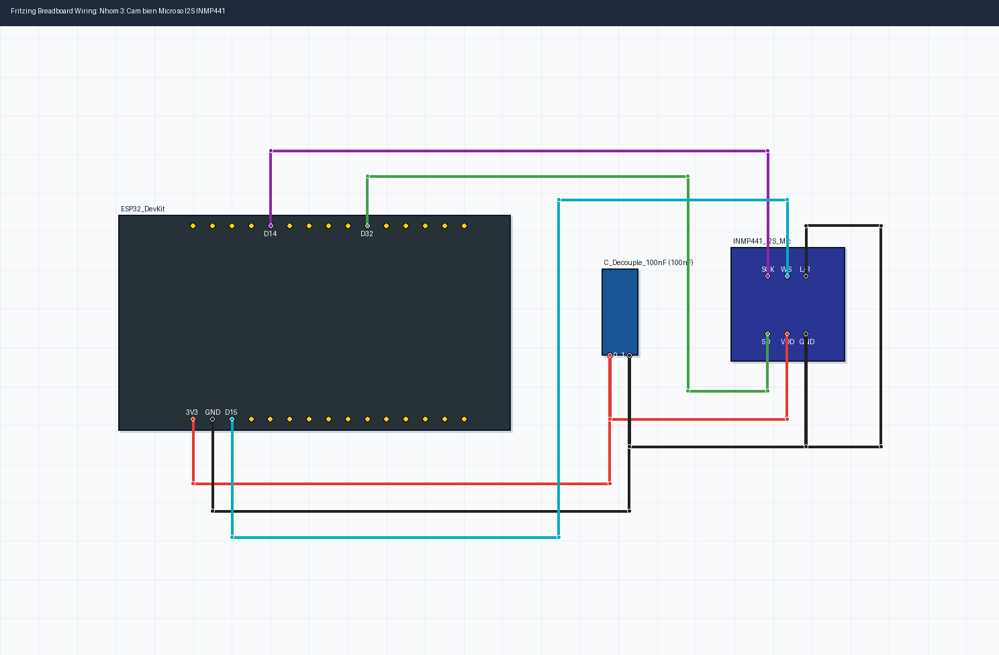

# Hướng Dẫn Test Nhóm 3: Cảm Biến Micro Số I2S INMP441, Thu Âm `.WAV` & Speech-to-Text



## 1. Danh mục linh kiện & Sơ đồ đấu dây (File Fritzing: `group3_mic_inmp441.fzz`)

### Linh kiện cần chuẩn bị:
- **Vi điều khiển**: ESP32 DevKit V1 (30 chân)
- **Cảm biến âm thanh**: Module Micro số I2S đa hướng `INMP441`
- **Linh kiện phụ trợ bắt buộc**:
  - `1 x Tụ gốm 100nF (104)`: Mắc song song sát chân `VDD (3.3V)` và `GND` của INMP441 để lọc nhiễu nguồn, giúp bản thu âm trong trẻo, không bị tiếng rè nền.

### Bảng đấu nối chi tiết:

| Chân INMP441 | Chân ESP32 | Màu dây Fritzing | Ghi chú |
| :--- | :--- | :--- | :--- |
| `VDD` | `3V3` | Đỏ | **Chỉ cấp 3.3V** (Tuyệt đối không cấp 5V!) + tụ lọc `100nF` |
| `GND` | `GND` | Đen | Mass chung |
| `L/R` | `GND` | Đen | Nối xuống `GND` để chọn thu kênh Trái (`Left Channel`) |
| `WS` | `GPIO15 (D15)` | Xanh ngọc (Cyan) | Word Select / Left-Right Clock (`LRCLK`) |
| `SCK` | `GPIO14 (D14)` | Tím | Serial Clock / Bit Clock (`BCLK`) |
| `SD` | `GPIO32 (D32)` | Xanh lá | Serial Data Output (`DOUT`) |

---

## 2. Bước 1: Kiểm tra Micro trực tiếp trên VS Code (VU Meter & Serial Plotter)

1. Mở thư mục `d:\Plant\sensor\3_mic_inmp441` bằng VS Code.
2. Nhấn **PlatformIO: Upload** để nạp firmware vào ESP32.
3. Mở **PlatformIO: Serial Monitor** (tốc độ **`921600` baud**).
4. **Kiểm tra hoạt động**:
   - Nói chuyện hoặc vỗ tay gần lỗ thu âm của micro INMP441.
   - Quan sát thanh **VU Meter** (`[###########--------------]`), giá trị `RMS`, `Peak` và `dBFS` thay đổi nhạy theo âm lượng giọng nói.
   - Gõ `+` hoặc `-` rồi nhấn Enter để tăng/giảm độ khuếch đại số (`Digital Gain`, mặc định `4x`).
   - Gõ `p` rồi nhấn Enter để chuyển sang chế độ vẽ sóng âm trên **Serial Plotter**.
5. **Lưu ý quan trọng**: Trước khi chuyển sang Bước 2 (Thu âm trên PC), hãy **đóng cửa sổ Serial Monitor trên VS Code** (nhấn biểu tượng thùng rác) để nhường cổng COM cho chương trình Python.

---

## 3. Bước 2: Thu âm lưu file `.WAV` và Chuyển giọng nói thành văn bản (Speech-to-Text)

Thư mục `pc_recorder_stt/` đi kèm chương trình Python `record_and_stt.py` giao tiếp trực tiếp với ESP32 qua cổng Serial (`921600` baud) để thu âm chuẩn `16.000 Hz, 16-bit Mono`, lưu thành file `.wav` và nhận diện giọng nói Tiếng Việt (`vi-VN`) hoặc Tiếng Anh (`en-US`).

### Cài đặt thư viện Python (chỉ cần chạy 1 lần):
```powershell
cd d:\Plant\sensor\3_mic_inmp441\pc_recorder_stt
pip install -r requirements.txt
```

### Cách chạy chương trình thu âm & Speech-to-Text:
1. **Chế độ tự động (tự dò cổng COM ESP32, thu 5 giây, Tiếng Việt `vi-VN`)**:
   ```powershell
   python record_and_stt.py
   ```
2. **Tuỳ chỉnh cổng COM, thời gian thu âm (ví dụ 6 giây) hoặc ngôn ngữ**:
   ```powershell
   python record_and_stt.py --port COM5 --duration 6 --lang vi-VN
   ```
3. **Chuyển Speech-to-Text lại từ một file `.wav` đã lưu trước đó**:
   ```powershell
   python record_and_stt.py --wav recordings/rec_20261108_234500.wav --lang vi-VN
   ```

### Kết quả đầu ra:
- **File âm thanh `.WAV`**: Được lưu tự động tại `pc_recorder_stt/recordings/rec_YYYYMMDD_HHMMSS.wav` (đã khử lệch DC và chuẩn hóa âm lượng, có thể mở nghe lại bằng bất kỳ trình phát nhạc nào trên Windows).
- **Văn bản nhận diện (Speech-to-Text)**: Hiển thị trực tiếp trên cửa sổ Terminal và được ghi nối tiếp kèm thời gian vào file nhật ký `pc_recorder_stt/recordings/transcripts.txt`.
