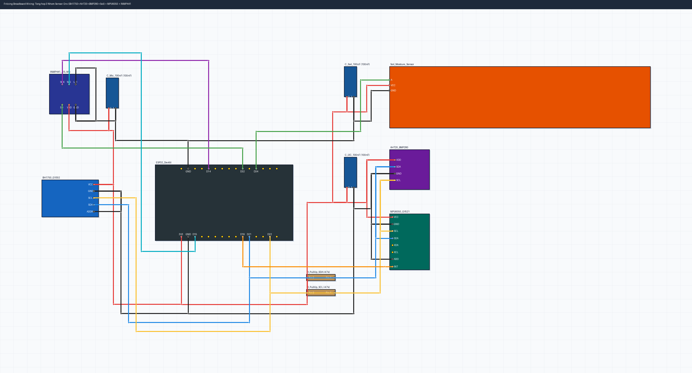
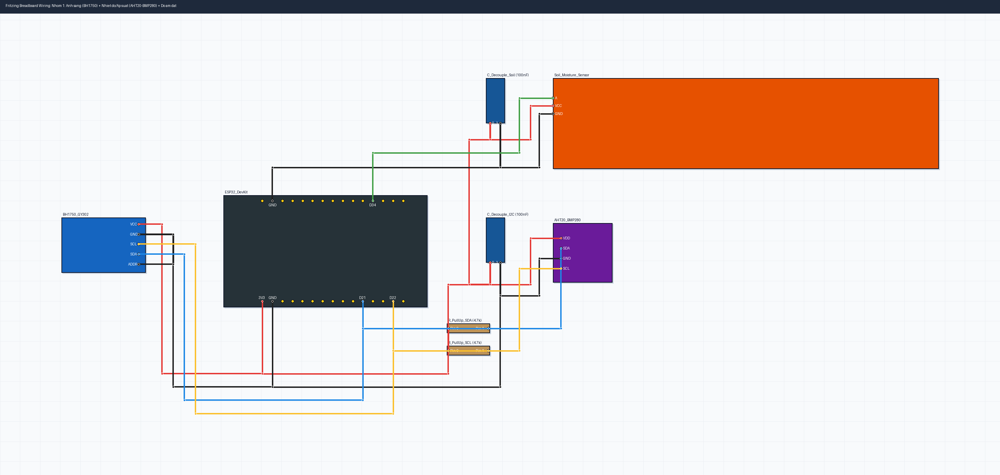
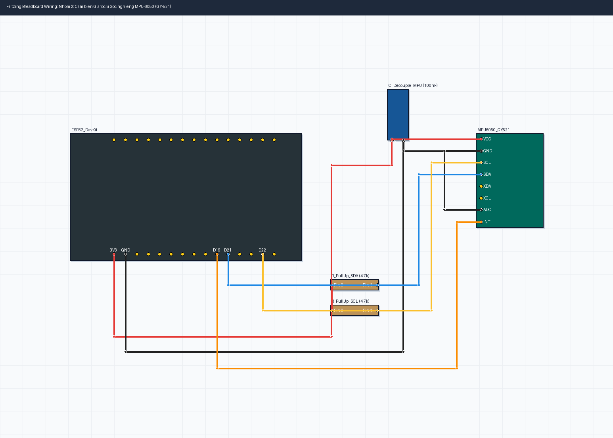
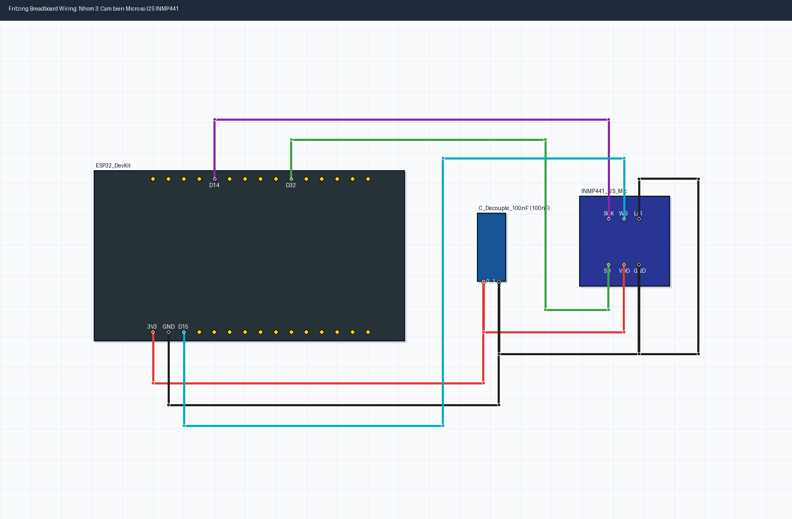

# Hướng Dẫn Đấu Nối & Test 3 Nhóm Cảm Biến (ESP32 - PlatformIO)

Tài liệu này hướng dẫn chi tiết cách đấu dây (trên **Fritzing** và thực tế), danh mục linh kiện phụ trợ bắt buộc (điện trở kéo lên, tụ lọc nguồn), cách nạp code qua **PlatformIO trên VS Code**, và quy trình kiểm tra từng nhóm cảm biến của dự án **Chậu Cây Thông Minh (Smart Plant Desktop Pet)**.

---

## 1. Cấu trúc thư mục `sensor/`

```text
d:\Plant\sensor\
├── platformio.ini                     # Cấu hình PlatformIO tích hợp 4 môi trường build
├── sensor_all_groups.fzz              # File Fritzing đi dây tổng hợp cả 3 nhóm cảm biến
├── wiring_all_groups.png              # Hình ảnh sơ đồ đi dây tổng hợp
├── HUONG_DAN_TEST.md                  # File hướng dẫn tổng hợp này
├── src\
│   └── main.cpp                       # Firmware All-in-One (chuyển chế độ 1, 2, 3 qua Serial)
│
├── 1_env_sensors\                     # [NHÓM 1]: Ánh sáng + Nhiệt độ/Độ ẩm/Áp suất + Độ ẩm đất
│   ├── group1_env_sensors.fzz         # File Fritzing đi dây riêng cho Nhóm 1
│   ├── wiring_group1.png              # Hình ảnh sơ đồ đi dây Nhóm 1
│   ├── platformio.ini                 # Cấu hình PlatformIO độc lập cho Nhóm 1
│   ├── src\main.cpp                   # Code firmware test Nhóm 1
│   └── HUONG_DAN_TEST.md              # Hướng dẫn test riêng Nhóm 1
│
├── 2_mpu6050\                         # [NHÓM 2]: Gia tốc & Góc nghiêng MPU-6050 (GY-521)
│   ├── group2_mpu6050.fzz             # File Fritzing đi dây riêng cho Nhóm 2
│   ├── wiring_group2.png              # Hình ảnh sơ đồ đi dây Nhóm 2
│   ├── platformio.ini                 # Cấu hình PlatformIO độc lập cho Nhóm 2
│   ├── src\main.cpp                   # Code firmware test Nhóm 2 (Có sẵn chế độ Hiệu chỉnh)
│   └── HUONG_DAN_TEST.md              # Hướng dẫn test & hiệu chỉnh MPU-6050
│
└── 3_mic_inmp441\                     # [NHÓM 3]: Cảm biến Micro số I2S INMP441
    ├── group3_mic_inmp441.fzz         # File Fritzing đi dây riêng cho Nhóm 3
    ├── wiring_group3.png              # Hình ảnh sơ đồ đi dây Nhóm 3
    ├── platformio.ini                 # Cấu hình PlatformIO độc lập cho Nhóm 3
    ├── src\main.cpp                   # Code firmware đọc I2S + truyền PCM 16kHz 16-bit
    ├── pc_recorder_stt\
    │   ├── record_and_stt.py          # Chương trình Python thu âm .WAV & Speech-to-Text
    │   └── requirements.txt           # Thư viện Python cần cài đặt
    └── HUONG_DAN_TEST.md              # Hướng dẫn test Micro, thu âm & chuyển giọng nói thành chữ
```

---

## 2. Sơ đồ đi dây tổng hợp & Linh kiện phụ trợ cần thiết



### Các linh kiện phụ trợ bắt buộc trong mạch (đã đi dây đủ trong các file `.fzz`):
1. **2 Điện trở kéo lên I2C `4.7kΩ` (`R_PullUp_SDA`, `R_PullUp_SCL`)**:
   - Mắc từ đường `SDA (GPIO21)` lên `3.3V` và từ đường `SCL (GPIO22)` lên `3.3V`.
   - **Tác dụng**: Giữ sườn xung I2C vuông vắn, chống treo bus I2C khi nối chung nhiều cảm biến (`BH1750`, `AHT20`, `BMP280`, `MPU-6050`) trên cùng một đường dây.
2. **Các tụ gốm lọc nhiễu nguồn `100nF` (Code `104`)**:
   - Mắc song song sát chân `VCC (3.3V)` và `GND` của từng cụm cảm biến (`C_I2C_100nF`, `C_Soil_100nF`, `C_Mic_100nF`).
   - **Tác dụng**: Khử nhiễu cao tần từ nguồn xung ESP32, giúp ADC đo độ ẩm đất không bị nhảy số, giảm nhiễu rung (noise floor) của MPU-6050 và loại bỏ tiếng rè nền khi thu âm bằng micro INMP441.
3. **Các chân chọn địa chỉ / chế độ cố định xuống `GND`**:
   - Chân `ADDR` của **BH1750** nối `GND` -> Cố định địa chỉ I2C ở `0x23`.
   - Chân `AD0` của **MPU-6050** nối `GND` -> Cố định địa chỉ I2C ở `0x68`.
   - Chân `L/R` của **INMP441** nối `GND` -> Chọn thu âm kênh Trái (`Left Channel`).

---

## 3. Hướng dẫn Test Nhóm 1: Ánh sáng + Nhiệt độ, Áp suất + Độ ẩm đất



### 3.1. Bảng đấu dây Nhóm 1 (File Fritzing: `1_env_sensors/group1_env_sensors.fzz`)

| Linh kiện | Chân Cảm biến | Chân ESP32 (30-Pin) | Ghi chú kỹ thuật |
| :--- | :--- | :--- | :--- |
| **BH1750 (GY-302)** | `VCC` | `3V3` | Nguồn 3.3V |
| | `GND` | `GND` | Mass chung |
| | `SDA` | `GPIO21 (D21)` | Kéo lên `3V3` qua trở `4.7kΩ` |
| | `SCL` | `GPIO22 (D22)` | Kéo lên `3V3` qua trở `4.7kΩ` |
| | `ADDR` | `GND` | Cố định địa chỉ I2C = `0x23` |
| **AHT20 + BMP280** | `VDD` | `3V3` | Kèm tụ lọc nguồn `100nF` sát chân `VDD - GND` |
| | `GND` | `GND` | Mass chung |
| | `SDA` | `GPIO21 (D21)` | Địa chỉ I2C: AHT20 = `0x38`, BMP280 = `0x77` (hoặc `0x76`) |
| | `SCL` | `GPIO22 (D22)` | Dùng chung bus I2C với BH1750 |
| **Độ ẩm đất điện dung** | `VCC` | `3V3` | Cấp 3.3V để ngõ ra `A` không vượt ngưỡng 3.3V của ESP32 |
| | `GND` | `GND` | Kèm tụ gốm `100nF` lọc nhiễu nguồn |
| | `A` (Analog Out) | `GPIO34 (D34)` | Chân `ADC1_CH6` (hoạt động ổn định cả khi bật Wi-Fi) |

### 3.2. Cách nạp code và kiểm tra Nhóm 1
1. Mở thư mục `d:\Plant\sensor\1_env_sensors` trong VS Code (hoặc mở `d:\Plant\sensor` và chọn môi trường `env:group1_env` ở thanh trạng thái dưới cùng).
2. Nhấn **PlatformIO: Upload** (`→`) và mở **Serial Monitor** ở tốc độ `115200` baud.
3. **Các bước kiểm tra thực tế**:
   - **Kiểm tra I2C Scanner**: Khi khởi động (hoặc nhấn phím `s`), màn hình sẽ báo tìm thấy đủ 3 địa chỉ: `0x23` (BH1750), `0x38` (AHT20), và `0x77`/`0x76` (BMP280).
   - **Test BH1750**: Lấy tay che kín cảm biến -> Giá trị giảm xuống `< 10 Lux` (`Trời tối / Tắt đèn`). Bật đèn flash điện thoại chiếu vào -> Giá trị tăng vọt lên `> 1000 Lux`.
   - **Test AHT20 & BMP280**: Hà hơi nhẹ vào cảm biến -> Độ ẩm không khí (`%RH`) và nhiệt độ (`°C`) tăng lên ngay lập tức; áp suất khí quyển hiển thị quanh mức `~1005 - 1015 hPa`.
   - **Hiệu chuẩn & Test Độ ẩm đất**:
     1. Để cảm biến độ ẩm đất khô ráo ngoài không khí, gõ phím **`d`** trong Serial Monitor để lưu mốc **0% (Đất khô)**.
     2. Nhúng phần vạch cảm biến vào cốc nước (không nhúng ngập phần mạch điện tử phía trên!), gõ phím **`w`** để lưu mốc **100% (Đất ướt)**. Thông số được lưu vĩnh viễn vào bộ nhớ Flash của ESP32.

---

## 4. Hướng dẫn Test Nhóm 2: Cảm biến Gia tốc & Góc nghiêng MPU-6050 (Có chế độ Hiệu chỉnh)



### 4.1. Bảng đấu dây Nhóm 2 (File Fritzing: `2_mpu6050/group2_mpu6050.fzz`)

| Chân MPU-6050 (GY-521) | Chân ESP32 (30-Pin) | Ghi chú kỹ thuật |
| :--- | :--- | :--- |
| `VCC` (pin 1) | `3V3` | Nguồn 3.3V + Tụ lọc gốm `100nF` nối xuống `GND` |
| `GND` (pin 2) | `GND` | Mass chung |
| `SCL` (pin 3) | `GPIO22 (D22)` | Có trở kéo lên `4.7kΩ` lên `3.3V` |
| `SDA` (pin 4) | `GPIO21 (D21)` | Có trở kéo lên `4.7kΩ` lên `3.3V` |
| `XDA` / `XCL` (pin 5, 6) | *Để trống* | Bus I2C phụ cho từ kế ngoài |
| `AD0` (pin 7) | `GND` | **Bắt buộc nối GND** để cố định địa chỉ I2C = `0x68` |
| `INT` (pin 8) | `GPIO19 (D19)` | Chân ngắt phần cứng báo dữ liệu mới / chuyển động |

### 4.2. Cách chạy Chế độ Hiệu chỉnh (Calibration) & Test MPU-6050
1. Mở thư mục `d:\Plant\sensor\2_mpu6050` (hoặc chọn `env:group2_mpu6050`), nạp code và mở **Serial Monitor** (`115200` baud).
2. **Quy trình Hiệu chỉnh tự động (Calibration)**:
   - Đặt module MPU-6050 (hoặc chậu cây) nằm **phẳng và đứng yên** trên mặt bàn.
   - Gõ phím **`c`** (hoặc `C`) vào Serial Monitor rồi nhấn Enter.
   - Chương trình đếm ngược 3 giây, sau đó tự động đọc **1000 mẫu** liên tiếp từ Accel & Gyro để tính toán sai số tĩnh (Bias Offset) sao cho khi nằm phẳng: `Ax = 0g`, `Ay = 0g`, `Az = +1.00g`, `Gx = Gy = Gz = 0°/s`.
   - Toàn bộ Offset được **tự động lưu vào bộ nhớ Flash NVS** của ESP32 (lần sau bật nguồn sẽ tự nạp lại, hiển thị nhãn `[CAL]`).
3. **Các phím chức năng khác**:
   - Phím **`z`**: Đặt góc nghiêng hiện tại về `0.0°` (Zero/Tare tại vị trí đặt chậu thực tế).
   - Phím **`p`**: Bật/tắt chế độ xuất dữ liệu cho **Serial Plotter** để xem đồ thị góc `Roll`, `Pitch` mượt theo thời gian thực.
   - Phím **`i`**: Xem lại bảng thông số Offset đang lưu trong Flash.
   - Phím **`r`**: Xóa thông số hiệu chỉnh về mặc định.
4. **Kiểm tra các phản xạ vật lý**:
   - **Gõ nhẹ 2 cái (Double-Tap)** vào cảm biến/thành chậu -> Serial in sự kiện `>>> [SỰ KIỆN] DOUBLE-TAP <<<`.
   - **Nghiêng quá 45°** -> Báo động `NGHIÊNG / NGÃ ĐỔ > 45°!`.
   - **Lắc mạnh** -> Báo động `RUNG LẮC MẠNH!`.

---

## 5. Hướng dẫn Test Nhóm 3: Cảm biến Micro INMP441, Thu âm `.WAV` & Speech-to-Text



### 5.1. Bảng đấu dây Nhóm 3 (File Fritzing: `3_mic_inmp441/group3_mic_inmp441.fzz`)

| Chân Micro INMP441 | Chân ESP32 (30-Pin) | Ghi chú kỹ thuật |
| :--- | :--- | :--- |
| `VDD` | `3V3` | **Chỉ cấp 3.3V** (Tuyệt đối không cấp 5V!) + Tụ lọc `100nF` sát chân `VDD-GND` |
| `GND` | `GND` | Mass chung |
| `L/R` | `GND` | Nối `GND` để chọn thu kênh Trái (`Left Channel`) |
| `WS` | `GPIO15 (D15)` | Xung chọn kênh trái/phải (`Word Select / LRCLK`) |
| `SCK` | `GPIO14 (D14)` | Xung nhịp dữ liệu bit (`Serial Clock / BCLK`) |
| `SD` | `GPIO32 (D32)` | Chân xuất dữ liệu âm thanh số (`Serial Data / DOUT`) |

### 5.2. Bước 1: Kiểm tra nhanh phần cứng Micro trên VS Code
1. Mở thư mục `d:\Plant\sensor\3_mic_inmp441` (hoặc chọn `env:group3_inmp441`) và nạp code xuống ESP32.
2. Mở **Serial Monitor** ở tốc độ **`921600` baud**.
3. Nói chuyện hoặc vỗ tay gần lỗ thu âm của INMP441:
   - Quan sát thanh **VU Meter** (`[##########---------------]`), chỉ số `RMS`, `Peak` và `dBFS` nhảy theo giọng nói.
   - Gõ `+` hoặc `-` để tăng/giảm độ nhạy thu âm (`Digital Gain`).
   - Gõ `p` nếu muốn mở **Serial Plotter** xem dạng sóng âm thanh.
4. **Quan trọng**: Sau khi kiểm tra xong trên Serial Monitor, hãy **TẮT (đóng) cửa sổ Serial Monitor trong VS Code** để giải phóng cổng COM cho chương trình thu âm Python ở Bước 2.

### 5.3. Bước 2: Chạy chương trình Thu âm, Lưu file `.WAV` và Chuyển Speech-to-Text trên máy tính
1. Mở Terminal (PowerShell hoặc CMD) tại thư mục `d:\Plant\sensor\3_mic_inmp441\pc_recorder_stt`:
   ```powershell
   cd d:\Plant\sensor\3_mic_inmp441\pc_recorder_stt
   pip install -r requirements.txt
   ```
2. Chạy chương trình thu âm & nhận diện giọng nói:
   ```powershell
   python record_and_stt.py
   ```
   *(Hoặc chỉ định rõ cổng COM, thời lượng thu 5 giây, ngôn ngữ Tiếng Việt: `python record_and_stt.py --port COM5 --duration 5 --lang vi-VN`)*
3. **Quy trình hoạt động của chương trình**:
   - Chương trình tự động dò cổng COM của ESP32, đếm ngược `3... 2... 1...` và gửi lệnh `REC:5` xuống ESP32.
   - Bạn nói trực tiếp vào micro INMP441 (ví dụ: *"Hôm nay nhiệt độ trong phòng là bao nhiêu độ?"*).
   - Chương trình thu luồng âm thanh số `16.000 Hz, 16-bit Mono`, tự động lọc nhiễu DC & chuẩn hóa âm lượng, lưu thành file `.wav` trong thư mục `recordings/rec_YYYYMMDD_HHMMSS.wav` (bạn có thể bấm đúp mở nghe lại ngay trên máy tính!).
   - Ngay lập tức, chương trình gửi đoạn âm thanh qua bộ nhận diện **Speech-to-Text (Tiếng Việt `vi-VN`)**, in câu văn bản nhận diện được lên màn hình và lưu lịch sử vào `recordings/transcripts.txt`.
